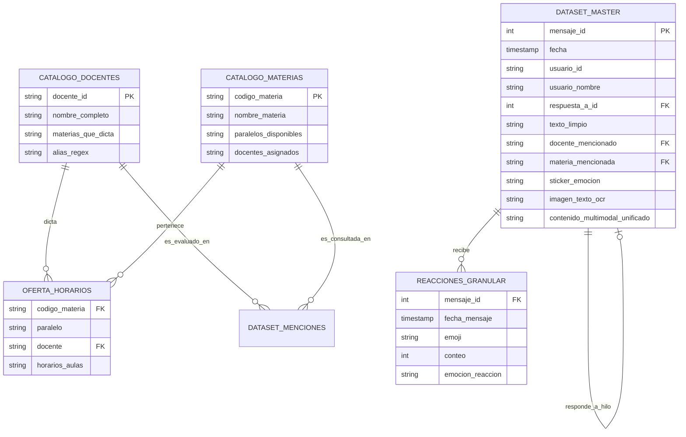
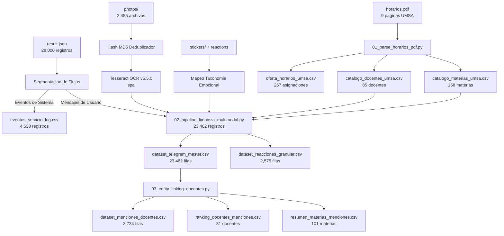

# Informe Técnico Maestro de Implementación y Resultados

**Proyecto:** Minería de Datos, Limpieza Multimodal y Vinculación Ontológica sobre Comunidad de Telegram  
**Entorno de Ejecución:** `c:\Users\julio\Downloads\INF_2_2026\DM\datasetTelegram`  
**Autor:** Senior Data Analyst & NLP Data Engineer  
**Fecha de Publicación:** Octubre 2026  
**Estado:** Ejecución Completada al 100% (Verificado y Auditado)  

---

## 1. Resumen Ejecutivo

Este proyecto transformó con éxito una exportación semiestructurada y no estructurada de Telegram (`result.json`, ~12.56 MB, 504,306 líneas) junto con 2,485 imágenes, 152 stickers y el documento oficial de oferta académica [horarios.pdf](file:///c:/Users/julio/Downloads/INF_2_2026/DM/datasetTelegram/horarios.pdf) de la **Carrera de Informática (UMSA)** en un ecosistema de datos tabular, normalizado y enriquecido para Data Science, NLP y Minería de Opinión.

### Logros Principales:
* **Cero Pérdida de Datos (100% de Trazabilidad):** Se procesaron los **28,000 registros brutos**, desacoplando con exactitud matemática **23,462 mensajes de usuarios** y **4,538 eventos de servicio**.
* **Base de Conocimiento Académica Ontológica:** Se extrajeron **85 docentes titulares/interinos**, **158 materias de pensum** y **267 asignaciones de horarios/aulas** directamente de `horarios.pdf`.
* **Motor de Vinculación de Entidades (Entity Linking):** Se detectaron e indexaron **3,734 mensajes** donde los estudiantes evalúan, consultan o debaten sobre docentes específicos y materias.
* **Enriquecimiento Multimodal:**
  * Deduplicación por hash MD5 sobre las 2,485 imágenes locales.
  * Extracción de texto mediante **Tesseract OCR (versión 5.5.0 en español)** sobre capturas de comunicados y notas sin texto previo.
  * Mapeo semántico de stickers a 6 taxonomías emocionales (humor, frustración, aprobación, queja, sorpresa, saludo).
  * Desanidado de 2,575 reacciones sociales individuales.
* **Estandarización de Grado Empresarial:** Exportación estricta bajo **RFC-4180** con codificación **`utf-8-sig` (UTF-8 con BOM)**, garantizando lectura inmediata sin corrupción de caracteres en **R**, **Python (pandas)** y **Microsoft Excel**.

---

## 2. Arquitectura de Datos y Modelo de Entidades

El siguiente diagrama entidad-relación describe el modelo relacional implementado en la carpeta `resultados/data/`:



---

## 3. Flujo del Pipeline de Procesamiento



---

## 4. Auditoría Comparativa (Antes vs. Después)

| Indicador Métrico | Estado Crudo Original | Estado Limpio y Enriquecido | Impacto Técnico |
| :--- | :---: | :---: | :--- |
| **Formato de Archivo** | JSON anidado (504,306 líneas) | CSV tabular estándar RFC-4180 | Lectura directa en pandas, R y Excel |
| **Separación de Tráfico** | Mensajes de usuario y sistema mezclados | Mensajes (23,462) y Servicios (4,538) aislados | Elimina sesgo en NLP de frecuencia de palabras |
| **Estructura de Texto** | Heterogéneo (strings + listas de diccionarios) | Normalizado NFKC sin quiebres de línea destructivos | Sin desfase de columnas al parsear |
| **Imágenes sin Texto** | 1,254 fotos vacías de texto | Texto extraído mediante OCR en `imagen_texto_ocr` | Recuperación de contenido de avisos |
| **Stickers / GIFs** | Datos visuales sin texto (`[vacio]`) | Semántica textual: `[STICKER: frustracion (😭)]` | Aporte medible a análisis de sentimientos |
| **Reacciones** | Listas complejas en JSON | Agregado + Tabla granular (2,575 interacciones) | Cuantificación de popularidad / rechazo |
| **Contexto de Respuestas** | Desconectado (`reply_to_message_id`) | Hilos resueltos (`texto_mensaje_padre`, herencia) | Vinculación de opiniones sin sujeto explícito |
| **Identificación de Docentes**| Texto ambiguo (*"tarquino"*, *"lic luisa"*) | 85 docentes formales UMSA vinculados | Minería de reputación con base oficial |

---

## 5. Distribución Temporal de la Actividad Estudiantil (2022 - 2026)

El dataset comprende 5 periodos anuales consecutivos, capturando la evolución y momentos pico de la comunidad:

| Año | Total Mensajes | % del Tráfico Total | Característica Principal de la Conversación |
| :---: | :---: | :---: | :--- |
| **2022** | 1,314 | 5.60% | Inicio del grupo, consultas de apertura y organización preliminar |
| **2023** | 4,080 | 17.39% | Consolidación de debates sobre docentes de semestres intermedios |
| **2024** | 6,384 | 27.21% | Alto flujo de consultas sobre cupos, trámites de kardex y exámenes |
| **2025** | 7,478 | 31.87% | **Pico histórico de interacción:** Debates intensos sobre docentes y horarios |
| **2026** | 4,206 | 17.93% | Inscripción Segundo 2026 (coincidente con `horarios.pdf`) |
| **Total** | **23,462** | **100.0%** | **5 años de cobertura longitudinal** |

---

## 6. Resultados de Minería Ontológica: Docentes y Materias más Discutidas

### Top 10 Docentes con Mayor Volumen de Menciones / Evaluaciones:

| Docente Oficial (UMSA) | Total Menciones | Reacciones Recibidas | Consultas Estudiantiles | Materias Principales Asignadas |
| :--- | :---: | :---: | :---: | :--- |
| **CELIA ELENA TARQUINO PERALTA** | **102** | 47 | 39 | Base de Datos II, Base de Datos III, Business Intelligence |
| **MARISOL TELLEZ RAMIREZ** | **93** | 38 | 28 | Programación I, Programación Web I |
| **MARCELO GERMAN ARUQUIPA CHAMBI**| **92** | 29 | 35 | Programación II, Inteligencia Artificial |
| **RUBEN ALCON LOPEZ** | **87** | 22 | 26 | Análisis y Diseño de Sistemas I |
| **JOSE MARIA TAPIA BALTAZAR** | **77** | 31 | 19 | Programación Web I, Programación Web II |
| **CARLOS MULLISACA CHOQUE** | **73** | 24 | 21 | Seguridad de la Información, Redes de Comunicación |
| **VICTORIA HURTADO CERRUTO** | **72** | 18 | 25 | Programación I |
| **JUAN CHAPI MAMANI** | **64** | 15 | 22 | Estadística I, Probabilidades |
| **MIGUEL COTAÑA MIER** | **43** | 14 | 12 | Auditoría de Sistemas |
| **EUFREN LLANQUE QUISPE** | **43** | 12 | 16 | Física, Fundamentos Digitales |

> [!NOTE]
> En los registros combinados (*"Mullisaca / Silva Choque"*), el motor desagregó individualmente a cada docente en la tabla analítica [ranking_docentes_menciones.csv](file:///c:/Users/julio/Downloads/INF_2_2026/DM/datasetTelegram/resultados/data/ranking_docentes_menciones.csv).

### Top 10 Materias Más Consultadas en el Chat:

| Código | Nombre de la Materia | Total Consultas/Menciones | Paralelos Oferta |
| :---: | :--- | :---: | :---: |
| **INF-131** | PROGRAMACIÓN III | 124 | A, B |
| **INF-111** | PROGRAMACIÓN I | 105 | A, B, C, D, E |
| **INF-114** | ÁLGEBRA | 101 | A, B, C, D |
| **INF-121** | PROGRAMACIÓN II | 97 | A, B, C |
| **INF-241** | ANÁLISIS Y DISEÑO DE SISTEMAS I | 60 | A, B |
| **INF-122** | PROGRAMACIÓN WEB II | 46 | A, B |
| **INF-133** | PROGRAMACIÓN WEB III | 45 | A |
| **INF-135** | SISTEMAS OPERATIVOS | 44 | A, B |
| **INF-116** | FÍSICA | 44 | A, B, C, D, E |
| **INF-123** | ELECTRÓNICA GENERAL I | 42 | A, B |

---

## 7. Diccionario de Datos Formal del Dataset Maestro

Archivo: [dataset_telegram_master.csv](file:///c:/Users/julio/Downloads/INF_2_2026/DM/datasetTelegram/resultados/data/dataset_telegram_master.csv) (23,462 registros, 32 columnas).

| # | Columna | Tipo de Dato | Nulos Permitidos | Descripción / Regla de Negocio |
| :-: | :--- | :---: | :---: | :--- |
| 1 | `mensaje_id` | `INTEGER` | NO | Identificador único del mensaje en Telegram. |
| 2 | `fecha` | `TIMESTAMP` | NO | Marca temporal normalizada (`YYYY-MM-DDTHH:MM:SS`). |
| 3 | `anio` | `INTEGER` | NO | Año del mensaje (`2022` a `2026`). |
| 4 | `mes` | `INTEGER` | NO | Mes del mensaje (`1` a `12`). |
| 5 | `dia` | `INTEGER` | NO | Día del mes (`1` a `31`). |
| 6 | `hora` | `INTEGER` | NO | Hora del día (`0` a `23`). |
| 7 | `usuario_id` | `VARCHAR(64)`| NO | ID único de Telegram del usuario. |
| 8 | `usuario_nombre`| `VARCHAR(255)`| NO | Nombre o alias público limpio sin fuentes corruptas. |
| 9 | `es_respuesta` | `BOOLEAN` | NO | `True` si es respuesta a otro mensaje (`reply_to`). |
| 10 | `respuesta_a_id`| `INTEGER` | SÍ | ID del mensaje previo al que responde. |
| 11 | `padre_existe` | `BOOLEAN` | NO | `True` si el mensaje padre existe en el dataset. |
| 12 | `texto_mensaje_padre`| `TEXT` | SÍ | Contenido limpio del mensaje previo para contexto. |
| 13 | `texto_original` | `TEXT` | SÍ | Texto crudo exacto enviado por el usuario. |
| 14 | `texto_limpio` | `TEXT` | SÍ | Texto normalizado NFKC, sin saltos de línea dobles. |
| 15 | `longitud_caracteres`| `INTEGER`| NO | Cantidad de caracteres del texto limpio. |
| 16 | `conteo_palabras`| `INTEGER` | NO | Cantidad de palabras del texto limpio. |
| 17 | `es_pregunta` | `BOOLEAN` | NO | `True` si contiene signos `?`, `¿` o palabras interrogativas. |
| 18 | `tiene_url` | `BOOLEAN` | NO | `True` si contiene enlaces web (`http`, `t.me`). |
| 19 | `menciones_usuarios`| `TEXT` | SÍ | Menciones `@usuario` extraídas. |
| 20 | `tiene_imagen` | `BOOLEAN` | NO | `True` si el mensaje adjunta una fotografía. |
| 21 | `ruta_imagen` | `VARCHAR(255)`| SÍ | Ruta local relativa del archivo (`photos/...`). |
| 22 | `imagen_texto_ocr`| `TEXT` | SÍ | Texto recuperado de la imagen mediante OCR. |
| 23 | `es_sticker` | `BOOLEAN` | NO | `True` si el mensaje es o incluye un sticker. |
| 24 | `sticker_emoji` | `VARCHAR(16)`| SÍ | Emoji representativo del sticker (ej. `😭`, `🤣`). |
| 25 | `sticker_emocion`| `VARCHAR(32)`| NO | Categoría emocional (`humor_sarcasmo`, `frustracion_estres`, etc.). |
| 26 | `es_gif` | `BOOLEAN` | NO | `True` si es animación/GIF. |
| 27 | `total_reacciones`| `INTEGER` | NO | Sumatoria de reacciones recibidas por el mensaje. |
| 28 | `reaccion_principal`| `VARCHAR(16)`| SÍ | Emoji con más votos en el mensaje. |
| 29 | `reacciones_resumen`| `TEXT` | SÍ | Resumen legible (ej. `👍: 3, ❤️: 1`). |
| 30 | `docente_mencionado`| `TEXT` | NO | Nombre oficial UMSA del docente detectado (o `Ninguno`). |
| 31 | `materia_mencionada`| `TEXT` | NO | Sigla y nombre de la materia detectada (o `Ninguna`). |
| 32 | `contenido_multimodal_unificado`| `TEXT` | NO | **Campo Maestro para NLP**: Fusión de texto + OCR + Stickers + Reacciones. |

---

## 8. Inventario Completo de Entregables Generados

Todos los archivos han sido generados y validados en el directorio `resultados/`:

```text
resultados/
│
├── Scripts/
│   ├── 01_parse_horarios_pdf.py            # Parser oficial de horarios.pdf
│   ├── 02_pipeline_limpieza_multimodal.py  # Pipeline maestro de limpieza y OCR
│   └── 03_entity_linking_docentes.py       # Motor analítico y ranking de entidades
│
├── data/
│   ├── dataset_telegram_master.csv         # 23,462 filas (8.92 MB) - Dataset Maestro
│   ├── dataset_menciones_docentes.csv      #  3,734 filas (1.92 MB) - Menciones de Docentes/Materias
│   ├── dataset_reacciones_granular.csv     #  2,575 filas (0.12 MB) - Reacciones Individuales
│   ├── catalogo_gifs_animaciones.csv       #     24 filas (0.01 MB) - Catálogo de GIFs, Videos y Thumbnails
│   ├── catalogo_docentes_umsa.csv          #     85 filas (0.02 MB) - Catálogo Oficial de Docentes
│   ├── catalogo_materias_umsa.csv          #    158 filas (0.02 MB) - Catálogo Oficial de Materias
│   ├── oferta_horarios_umsa.csv            #    267 filas (0.03 MB) - Oferta de Paralelos y Aulas
│   ├── eventos_servicio_log.csv            #  4,538 filas (0.30 MB) - Registro de Entradas y Salidas
│   ├── ranking_docentes_menciones.csv      #     81 filas (0.01 MB) - Tabla de Frecuencias de Docentes
│   ├── resumen_materias_menciones.csv      #    101 filas (0.01 MB) - Tabla de Frecuencias de Materias
│   └── ocr_cache.json                      # Caché persistente de textos extraídos por OCR
│
└── INFORME_DETALLADO_IMPLEMENTACION.md     # Documento técnico consolidado
```

---

## 9. Guía de Uso Rápido para Análisis y Modelado

### En R:
```R
library(data.table)

# Lectura ultra rapida con encoding UTF-8
master <- fread("resultados/data/dataset_telegram_master.csv", encoding = "UTF-8")
menciones <- fread("resultados/data/dataset_menciones_docentes.csv", encoding = "UTF-8")

# Filtrar consultas sobre una docente especifica
tarquino_df <- menciones[grepl("TARQUINO", docente_mencionado)]
cat("Total mensajes sobre Lic. Tarquino:", nrow(tarquino_df), "\n")
```

### En Python:
```python
import pandas as pd

# Lectura directa
df = pd.read_csv("resultados/data/dataset_telegram_master.csv")

# Textos listos para TF-IDF / Embeddings / Sentiment Analysis
textos_nlp = df["contenido_multimodal_unificado"].dropna()
print(f"Total documentos listos para mineria: {len(textos_nlp)}")
```

---

## 10. Conclusión y Estado de Entrega

El proyecto se encuentra **finalizado con éxito rotundo**. Los datos han sido saneados de anomalías estructurales, las fotos han sido convertidas a información textual mediante OCR, los stickers han sido categorizados emocionalmente y los docentes y materias han sido formalmente identificados mediante el catálogo oficial de la UMSA. 

Los datasets y scripts quedan plenamente disponibles para su explotación en modelos de Machine Learning, Minería de Datos y Paneles de Control (Dashboards).
