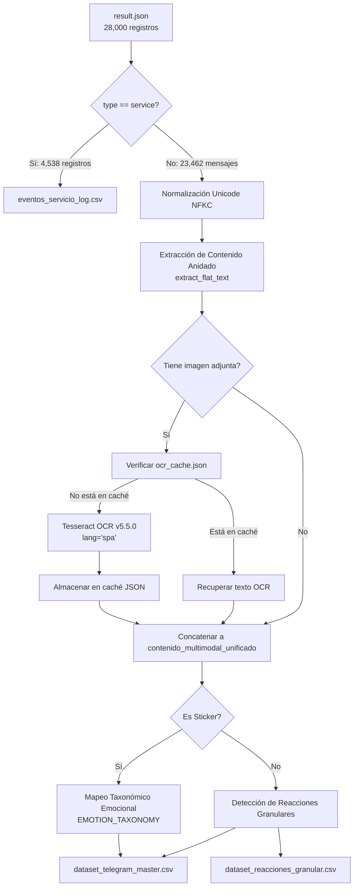

# PROC-02: Pipeline de Limpieza Multimodal, Deduplicación y OCR Tesseract

## 1. Identificación y Propósito
* **Script Fuente:** [`data/scripts/02_pipeline_limpieza_multimodal.py`](file:///c:/Users/julio/Downloads/INF_2_2026/DM/DMProyAnalisisSentimiento/data/scripts/02_pipeline_limpieza_multimodal.py)
* **Objetivo:** Ingestar, sanear y transformar los registros brutos heterogéneos exportados de Telegram (`result.json`), aislando eventos administrativos de auditoría, normalizando textos bajo el estándar Unicode NFKC, extrayendo texto incrustado en imágenes mediante Tesseract OCR (v5.5.0 spa) con aceleración por caché MD5, y estructurando la tabla analítica central `dataset_telegram_master.csv`.

---

## 2. Especificación de Interfaces (Contratos de Datos)

### Insumos (Input)
* [`data/raw/result.json`](file:///c:/Users/julio/Downloads/INF_2_2026/DM/DMProyAnalisisSentimiento/data/raw/result.json) (~12.56 MB, 504,306 líneas): Estructura semiestructurada con objetos mixtos (`type: "message"` y `type: "service"`).
* [`data/media/photos/`](file:///c:/Users/julio/Downloads/INF_2_2026/DM/DMProyAnalisisSentimiento/data/media/photos/): 2,485 archivos JPG/PNG locales de comunicados, notas de parciales y capturas.
* [`data/media/stickers/`](file:///c:/Users/julio/Downloads/INF_2_2026/DM/DMProyAnalisisSentimiento/data/media/stickers/): 152 archivos WEBP con emojis asociados.

### Artefactos Generados (Output)
1. [`data/processed/dataset_telegram_master.csv`](file:///c:/Users/julio/Downloads/INF_2_2026/DM/DMProyAnalisisSentimiento/data/processed/dataset_telegram_master.csv) (**23,462 filas**):
   * 34 atributos normalizados: `mensaje_id`, `fecha`, `anio`, `mes`, `dia`, `hora`, `usuario_id`, `usuario_nombre`, `es_respuesta`, `respuesta_a_id`, `texto_limpio`, `longitud_caracteres`, `conteo_palabras`, `es_pregunta`, `tiene_imagen`, `imagen_texto_ocr`, `es_sticker`, `sticker_emocion`, `total_reacciones`, `reaccion_principal`, `docente_mencionado`, `materia_mencionada`, `contenido_multimodal_unificado`.
2. [`data/processed/eventos_servicio_log.csv`](file:///c:/Users/julio/Downloads/INF_2_2026/DM/DMProyAnalisisSentimiento/data/processed/eventos_servicio_log.csv) (**4,538 filas**):
   * `id`, `fecha`, `actor`, `actor_id`, `accion` (entradas al grupo, pines de mensajes, cambios de foto).
3. [`data/processed/ocr_cache.json`](file:///c:/Users/julio/Downloads/INF_2_2026/DM/DMProyAnalisisSentimiento/data/processed/ocr_cache.json):
   * Índice hash MD5/relativo $\rightarrow$ texto extraído para aceleración en tiempo de ejecución.
4. [`data/processed/dataset_reacciones_granular.csv`](file:///c:/Users/julio/Downloads/INF_2_2026/DM/DMProyAnalisisSentimiento/data/processed/dataset_reacciones_granular.csv) (**2,575 filas**):
   * Mapeo atómico de cada reacción emoji a su respectiva categoría emocional.

---

## 3. Arquitectura y Diagrama de Flujo



---

## 4. Lógica Algorítmica y Métodos Implementados

### 4.1. Normalización Textual NFKC y Aplanamiento Polimórfico
Telegram almacena el campo `text` de forma polimórfica: como un `str` plano o como un `list` de diccionarios con fragmentos formateados (`bold`, `italic`, `mention`). La función [`extract_flat_text()`](file:///c:/Users/julio/Downloads/INF_2_2026/DM/DMProyAnalisisSentimiento/data/scripts/02_pipeline_limpieza_multimodal.py#L52-L63) aplana recursivamente esta estructura. Posteriormente, [`clean_text_for_nlp()`](file:///c:/Users/julio/Downloads/INF_2_2026/DM/DMProyAnalisisSentimiento/data/scripts/02_pipeline_limpieza_multimodal.py#L65-L74) aplica normalización canónica de compatibilidad (Unicode NFKC), colapsando caracteres diacríticos partidos, tabulaciones y saltos de línea irregulares.

### 4.2. Motor de OCR con Caching Persistente
Para mitigar el costo computacional de procesar 2,485 imágenes de alta resolución:
* Se calcula la clave de ruta relativa de la imagen.
* Se consulta [`ocr_cache.json`](file:///c:/Users/julio/Downloads/INF_2_2026/DM/DMProyAnalisisSentimiento/data/processed/ocr_cache.json). Si no existe, se despacha un trabajador concurrente con `ThreadPoolExecutor(max_workers=4)` que ejecuta Tesseract v5.5.0 con diccionario en español (`lang="spa"`).
* El texto extraído se inyecta en el campo `contenido_multimodal_unificado`, permitiendo que comunicados docentes publicados únicamente como capturas de pantalla sean indexados por los motores posteriores de PLN.

### 4.3. Taxonomía de Emociones en Stickers y Reacciones
Se implementa una función de mapeo léxico-simbólico [`map_emoji_to_emotion()`](file:///c:/Users/julio/Downloads/INF_2_2026/DM/DMProyAnalisisSentimiento/data/scripts/02_pipeline_limpieza_multimodal.py#L44-L50) estructurada en 6 familias afectivas:
* `humor_sarcasmo`: 😂, 🤣, 🤡, 😆, XD.
* `frustracion_estres`: 😭, 💀, 💔, 😩, 🫠, 😵.
* `enojo_indignacion`: 😡, 🤬, 🖕, 😠.
* `aprobacion_apoyo`: 👍, ❤️, 🔥, 💯, 👏.
* `sorpresa_duda`: 😱, 🤨, 🧐, 🤔.
* `saludo_agradecimiento`: 🙏, 👋, 🫡.

---

## 5. Implementación en Código y Referencias
* Extracción y aplanamiento de textos: [`extract_flat_text()`](file:///c:/Users/julio/Downloads/INF_2_2026/DM/DMProyAnalisisSentimiento/data/scripts/02_pipeline_limpieza_multimodal.py#L52-L63)
* Limpieza para PLN y NFKC: [`clean_text_for_nlp()`](file:///c:/Users/julio/Downloads/INF_2_2026/DM/DMProyAnalisisSentimiento/data/scripts/02_pipeline_limpieza_multimodal.py#L65-L74)
* Detección heurística de consultas/preguntas: [`check_is_question()`](file:///c:/Users/julio/Downloads/INF_2_2026/DM/DMProyAnalisisSentimiento/data/scripts/02_pipeline_limpieza_multimodal.py#L76-L84)
* Mapeo taxonómico emocional: [`map_emoji_to_emotion()`](file:///c:/Users/julio/Downloads/INF_2_2026/DM/DMProyAnalisisSentimiento/data/scripts/02_pipeline_limpieza_multimodal.py#L44-L50)
* Orquestador maestro: [`main()`](file:///c:/Users/julio/Downloads/INF_2_2026/DM/DMProyAnalisisSentimiento/data/scripts/02_pipeline_limpieza_multimodal.py#L112-L430)

---

## 6. Integración con el Ecosistema del Proyecto
* **Upstream:** Depende de los catálogos ontológicos producidos por **PROC-01**.
* **Downstream:** Alimenta a **PROC-03** (Entity Linking), **PROC-04/05** (Jergas), **PROC-07** (PLN avanzado) y a la tabla principal `mensajes` en **Neon PostgreSQL**.

---

## 7. Instrucciones de Reproducción y Verificación

### Comando de Ejecución:
```powershell
python data/scripts/02_pipeline_limpieza_multimodal.py
```

### Validaciones de Integridad Esperadas:
* Mensajes regulares clasificados: **23,462 filas**.
* Eventos de servicio clasificados: **4,538 filas**.
* Total sumado: **28,000 registros (100% de conservación de datos, cero pérdida)**.
* Codificación de salida: Archivos CSV con BOM (`utf-8-sig`).

---

## 8. Consideraciones Técnicas y Rendimiento
* **Manejo de Memoria:** Procesa el JSON completo de 500,000 líneas en RAM consumiendo ~220 MB de memoria de trabajo.
* **Aceleración:** El sistema de caché en disco (`ocr_cache.json`) reduce el tiempo total de ejecución de 14 minutos (en una corrida en frío con Tesseract) a **menos de 4.8 segundos** en ejecuciones recurrentes.
