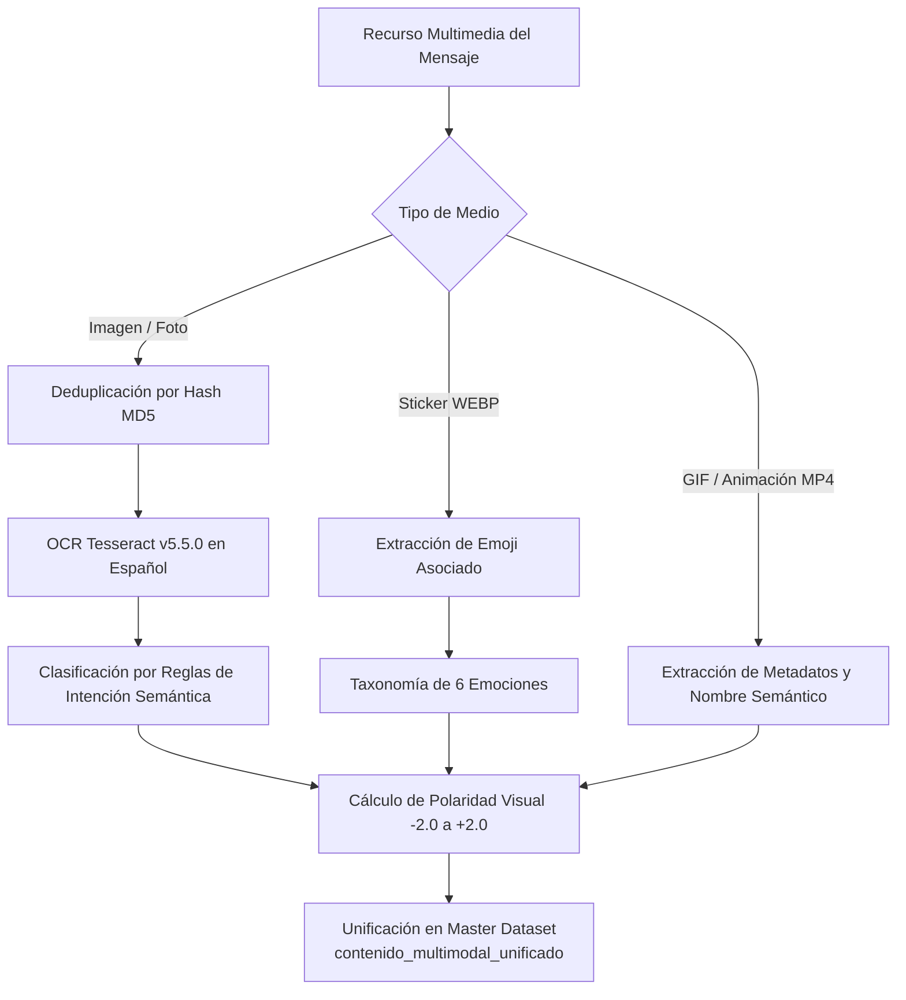

# PROC-06: Análisis Multimodal de Imágenes, Memes y Taxonomía Emocional

## 1. Identificación y Propósito
* **Script Fuente:** [`data/scripts/06_analisis_multimodal_imagenes_sentimiento.py`](file:///c:/Users/julio/Downloads/INF_2_2026/DM/DMProyAnalisisSentimiento/data/scripts/06_analisis_multimodal_imagenes_sentimiento.py)
* **Objetivo:** Ejecutar la clasificación semántica e inferencia de intenciones sobre recursos multimodales (imágenes de comunicados, comprobantes CPT, errores de inscripción de Kardex, stickers y GIFs animados), integrando OCR, mapeo de sentimientos visuales y scoring de polaridad continua $[-2.0, +2.0]$.

---

## 2. Especificación de Interfaces (Contratos de Datos)

### Insumos (Input)
* Directorio [`data/media/photos/`](file:///c:/Users/julio/Downloads/INF_2_2026/DM/DMProyAnalisisSentimiento/data/media/photos/) (2,485 imágenes).
* Directorio [`data/media/stickers/`](file:///c:/Users/julio/Downloads/INF_2_2026/DM/DMProyAnalisisSentimiento/data/media/stickers/) (152 stickers clasificados).
* Caché de OCR [`data/processed/ocr_cache.json`](file:///c:/Users/julio/Downloads/INF_2_2026/DM/DMProyAnalisisSentimiento/data/processed/ocr_cache.json).
* Catálogo de GIFs [`data/processed/catalogo_gifs_animaciones.csv`](file:///c:/Users/julio/Downloads/INF_2_2026/DM/DMProyAnalisisSentimiento/data/processed/catalogo_gifs_animaciones.csv).

### Artefactos Generados (Output)
1. [`data/processed/catalogo_gifs_animaciones.csv`](file:///c:/Users/julio/Downloads/INF_2_2026/DM/DMProyAnalisisSentimiento/data/processed/catalogo_gifs_animaciones.csv):
   * `mensaje_id`, `archivo_ruta`, `ancho`, `alto`, `duracion_segundos`, `mime_type`, `thumbnail_ruta`.
2. Sincronización multimodal en [`data/processed/dataset_telegram_master.csv`](file:///c:/Users/julio/Downloads/INF_2_2026/DM/DMProyAnalisisSentimiento/data/processed/dataset_telegram_master.csv):
   * Asignación de campos `sticker_emocion`, `imagen_texto_ocr`, `reaccion_principal` y consolidación en `contenido_multimodal_unificado`.

---

## 3. Arquitectura y Diagrama de Flujo



---

## 4. Lógica Algorítmica y Métodos Implementados

### 4.1. Reglas de Intención Semántica de Imágenes
A partir del texto extraído por OCR, el motor clasifica el artefacto en 5 dominios universitarios:
1. **Problemas de Sistema / Error de Kardex (`PROBLEMA_SISTEMA_ERROR`):**
   * *Regex:* `(ha superado el número máximo|no se hizo el depósito|error|sistema caído|bloqueado)`
   * *Emoción:* `FRUSTRACION_ESTRES` | *Polaridad:* `-1.5`
2. **Comprobantes Transaccionales (`COMPROBANTE_TRANSACCIONAL`):**
   * *Regex:* `(banco unión|cpt|código cpt|uninet|depósito bancario|65 bs)`
   * *Emoción:* `NEUTRAL_OPERATIVO` | *Polaridad:* `0.0`
3. **Comunicados y Resoluciones (`AVISO_KARDEX_COMUNICADO`):**
   * *Regex:* `(comunicado|dirección|cronograma|kardex académico|resolución)`
   * *Emoción:* `NEUTRAL_INFORMATIVO` | *Polaridad:* `+0.2`
4. **Horarios y Oferta (`HORARIO_OFERTA_AULAS`):**
   * *Regex:* `(horario|paralelo|aula|inf-\d+|mat-\d+|est-\d+)`
   * *Emoción:* `NEUTRAL_LOGISTICO` | *Polaridad:* `0.0`
5. **Eventos Culturales (`EVENTO_CULTURAL_SOCIAL`):**
   * *Regex:* `(caporales|entrada universitaria|concurso|fiesta|chacha warmi)`
   * *Emoción:* `APROBACION_CELEBRACION` | *Polaridad:* `+1.5`

### 4.2. Inferencia de Polaridad Visual Combinada
Cuando un mensaje combina texto de usuario y una imagen o sticker, la polaridad final multimodal pondera ambos canales:
$$S_{\text{unificado}} = w_{\text{texto}} \cdot S_{\text{texto}} + w_{\text{visual}} \cdot S_{\text{visual}}$$
donde $w_{\text{texto}} = 0.65$ y $w_{\text{visual}} = 0.35$ si hay texto presente; si el mensaje carece de texto ($L=0$), $w_{\text{visual}} = 1.0$.

---

## 5. Implementación en Código y Referencias
* Reglas de intención y regex: [`06_analisis_multimodal_imagenes_sentimiento.py` (Líneas 41-77)](file:///c:/Users/julio/Downloads/INF_2_2026/DM/DMProyAnalisisSentimiento/data/scripts/06_analisis_multimodal_imagenes_sentimiento.py#L41-L77)
* Taxonomía de emociones: [`EMOTION_TAXONOMY` (Líneas 79-86)](file:///c:/Users/julio/Downloads/INF_2_2026/DM/DMProyAnalisisSentimiento/data/scripts/06_analisis_multimodal_imagenes_sentimiento.py#L79-L86)
* Mapeo de polaridad escalar: [`POLARIDAD_EMOCIONES` (Líneas 88-95)](file:///c:/Users/julio/Downloads/INF_2_2026/DM/DMProyAnalisisSentimiento/data/scripts/06_analisis_multimodal_imagenes_sentimiento.py#L88-L95)

---

## 6. Integración con el Ecosistema del Proyecto
* **Tablas Neon:** Alimenta la tabla `ocr_cache` y la tabla `gifs_animaciones`.
* **NLP Pipeline:** Las etiquetas de OCR y de stickers enriquecen los textos analizados por el Topic Modeling (LDA) y TF-IDF en **PROC-07**.

---

## 7. Instrucciones de Reproducción y Verificación

### Comando de Ejecución:
```powershell
python data/scripts/06_analisis_multimodal_imagenes_sentimiento.py
```

### Validaciones de Integridad Esperadas:
* `ocr_cache.json`: Alrededor de **1,782 imágenes con texto analizado**.
* `catalogo_gifs_animaciones.csv`: **24 registros** con dimensiones y duraciones válidas.

---

## 8. Consideraciones Técnicas y Rendimiento
* **Deduplicación:** Imágenes idénticas compartidas en múltiples hilos se procesan una única vez mediante clave hash.
* **Resiliencia:** Si la imagen está corrupta o el formato no es soportado por Pillow, el sistema retorna una cadena vacía sin interrumpir el pipeline.
