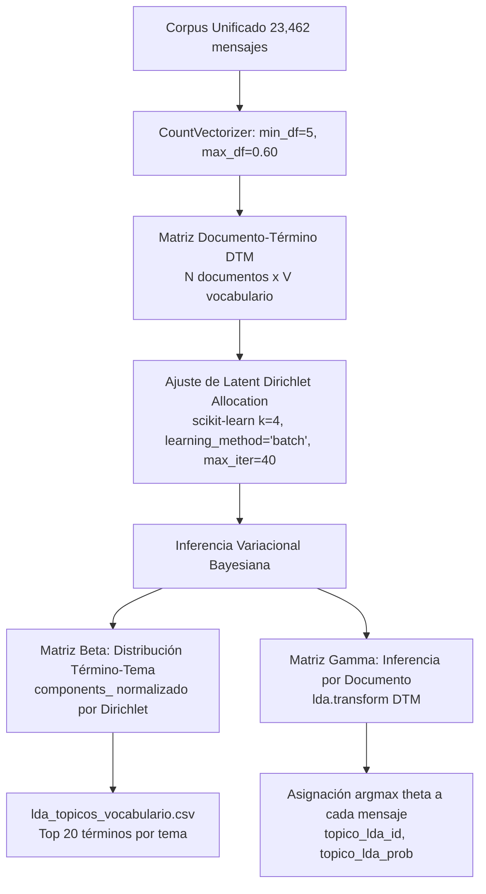

# PROC-07B: Modelado Temático Latente (LDA k=4, Matrices Beta y Gamma)

## 1. Identificación y Propósito
* **Script Fuente:** [`data/scripts/07_pipeline_nlp_avanzado.py` (Líneas 536-640)](file:///c:/Users/julio/Downloads/INF_2_2026/DM/DMProyAnalisisSentimiento/data/scripts/07_pipeline_nlp_avanzado.py#L536-L640)
* **Objetivo:** Descubrir automáticamente las estructuras temáticas latentes no supervisadas que subyacen en las 23,462 conversaciones estudiantiles mediante **Latent Dirichlet Allocation (LDA)** fijando $k=4$ tópicos, extrayendo la **Matriz $\beta$** (distribución de vocabulario por tópico) y la **Matriz $\gamma / \theta$** (distribución de tópicos por mensaje).

---

## 2. Especificación de Interfaces (Contratos de Datos)

### Insumos (Input)
* Corpus textual enriquecido: Columna `contenido_multimodal_unificado` de [`dataset_telegram_master.csv`](file:///c:/Users/julio/Downloads/INF_2_2026/DM/DMProyAnalisisSentimiento/data/processed/dataset_telegram_master.csv).
* Matriz de Conteo Término-Documento (DTM) generada con `CountVectorizer(min_df=5, max_df=0.60, ngram_range=(1,2))`.

### Artefactos Generados (Output)
1. [`data/processed/lda_topicos_vocabulario.csv`](file:///c:/Users/julio/Downloads/INF_2_2026/DM/DMProyAnalisisSentimiento/data/processed/lda_topicos_vocabulario.csv):
   * `topico_id` ($0$ a $3$), `nombre_etiqueta`, `termino`, `beta_prob` (probabilidad Dirichlet), `ranking_pos`.
2. Asignación tópica por documento en [`dataset_telegram_master.csv`](file:///c:/Users/julio/Downloads/INF_2_2026/DM/DMProyAnalisisSentimiento/data/processed/dataset_telegram_master.csv) y [`dataset_menciones_docentes.csv`](file:///c:/Users/julio/Downloads/INF_2_2026/DM/DMProyAnalisisSentimiento/data/processed/dataset_menciones_docentes.csv):
   * Columnas agregadas: `topico_lda_id` (tópico de máxima verosimilitud) y `topico_lda_prob` (probabilidad a posteriori $\theta_{d, k}$).

---

## 3. Arquitectura y Diagrama de Flujo



---

## 4. Lógica Algorítmica y Métodos Implementados

### 4.1. Formulación Probabilística de LDA
LDA asume el siguiente proceso generativo bayesiano para cada mensaje $d \in D$:
1. Se extrae una distribución de tópicos $\theta_d \sim \text{Dirichlet}(\alpha)$.
2. Para cada una de las $N_d$ palabras en el mensaje $w_{d, n}$:
   - Se extrae un tópico latente $z_{d, n} \sim \text{Multinomial}(\theta_d)$.
   - Se extrae una palabra observada $w_{d, n} \sim \text{Multinomial}(\beta_{z_{d, n}})$, donde $\beta_k \sim \text{Dirichlet}(\eta)$.

La matriz $\beta$ se normaliza explícitamente:
$$\beta_{k, v} = P(w_v \mid z = k) = \frac{\text{components}_{k, v}}{\sum_{v'=1}^V \text{components}_{k, v'}}$$

### 4.2. Caracterización Semántica de los 4 Tópicos
A partir del análisis de coherencia de las palabras con mayor $\beta_{k, v}$, se asignaron etiquetas conceptuales interpretables:

| ID | Tópico Asignado | Términos Clave de Alta Probabilidad ($\beta$) | Interpretación Operativa |
| :---: | :--- | :--- | :--- |
| **0** | **Evaluaciones, Parciales y Exámenes** | *parcial*, *nota*, *examen*, *segundo parcial*, *final*, *habilitado*, *puntos* | Discusión sobre calendarios de pruebas y reclamo de calificaciones. |
| **1** | **Gestión Académica, Horarios e Inscripción** | *horario*, *paralelo*, *inscripcion*, *kardex*, *cupos*, *cpt*, *materias* | Consultas operativas de matrícula, pagos bancarios y solapamiento de horas. |
| **2** | **Docencia, Criterios de Aprobación y Dificultad** | *docente*, *licen*, *barco*, *yuca*, *fregado*, *enseña*, *recomiendan*, *pasa* | Evaluación cualitativa y deliberación sobre reputación de profesores. |
| **3** | **Auxiliaturas, Laboratorios y Consultas Prácticas** | *auxi*, *auxiliar*, *laboratorio*, *defensa*, *practica*, *proyecto*, *codigo* | Dudas sobre tareas, entornos de desarrollo, entregas y ayudantías. |

---

## 5. Implementación en Código y Referencias
* Función de modelado LDA: [`ejecutar_topic_modeling_lda()`](file:///c:/Users/julio/Downloads/INF_2_2026/DM/DMProyAnalisisSentimiento/data/scripts/07_pipeline_nlp_avanzado.py#L536-L640)
* Asignación de etiquetas conceptuales: [`etiquetas_topicos` (Líneas 570-575)](file:///c:/Users/julio/Downloads/INF_2_2026/DM/DMProyAnalisisSentimiento/data/scripts/07_pipeline_nlp_avanzado.py#L570-L575)

---

## 6. Integración con el Ecosistema del Proyecto
* **Almacenamiento:** Se persiste en la tabla `lda_topicos` en Neon Serverless.
* **Dashboard:** La sección [`nlp_section.html`](file:///c:/Users/julio/Downloads/INF_2_2026/DM/DMProyAnalisisSentimiento/app/templates/components/dashboard/nlp_section.html) renderiza las 4 tarjetas temáticas con barras de probabilidad y términos más representativos.

---

## 7. Instrucciones de Reproducción y Verificación

### Comando de Ejecución:
```powershell
python data/scripts/07_pipeline_nlp_avanzado.py
```

### Validaciones de Integridad Esperadas:
* `lda_topicos_vocabulario.csv`: Exactamente **80 filas** (20 términos $\times$ 4 temas).
* Distribución Gamma $\theta_d$: Para cada mensaje, $\sum_{k=0}^3 \theta_{d, k} = 1.0 \pm 10^{-5}$.

---

## 8. Consideraciones Técnicas y Rendimiento
* **Convergencia:** El estimador variacional `batch` alcanza la convergencia en 40 iteraciones en aproximadamente **8.5 segundos** sobre CPU multi-hilo (`n_jobs=-1`).
* **Estabilidad:** Se fija `random_state=42` para garantizar reproducibilidad matemática exacta en auditorías.
