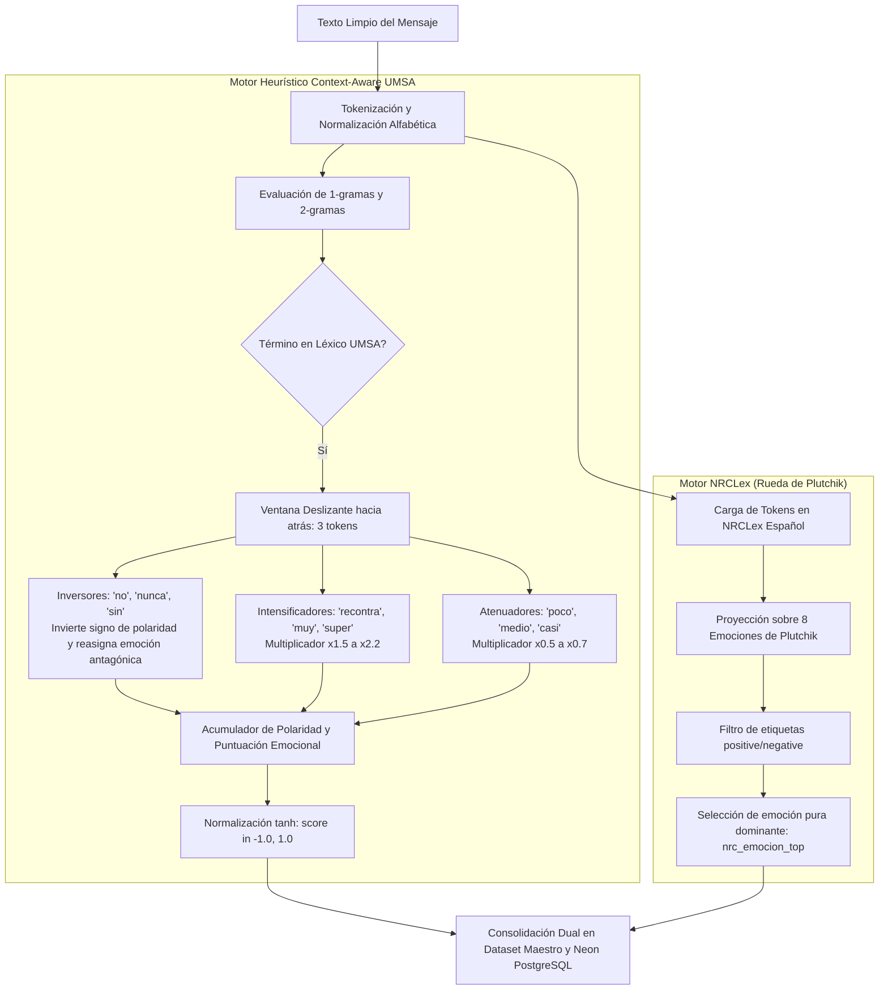

# PROC-07C: Análisis Dual de Sentimientos (Motor Heurístico UMSA vs. NRCLex Plutchik)

## 1. Identificación y Propósito
* **Script Fuente:** [`data/scripts/07_pipeline_nlp_avanzado.py` (Líneas 71-355 y 643-689)](file:///c:/Users/julio/Downloads/INF_2_2026/DM/DMProyAnalisisSentimiento/data/scripts/07_pipeline_nlp_avanzado.py#L71-L355)
* **Objetivo:** Resolver el desafío de interpretar la opinión y afectividad estudiantil boliviana mediante una arquitectura **dual y complementaria**:
  1. Un **Motor Heurístico Context-Aware Nativo** (sin dependencias de inferencia de terceros), diseñado para jerga paceña y evaluación académica con ventana deslizante de 3 tokens con detección de inversores, intensificadores y atenuadores.
  2. Un **Motor Basado en Librerías (NRCLex)** adaptado al español para proyectar las 8 emociones primarias de la rueda de Plutchik.

---

## 2. Especificación de Interfaces (Contratos de Datos)

### Insumos (Input)
* [`data/processed/lexico_emociones_umsa.json`](file:///c:/Users/julio/Downloads/INF_2_2026/DM/DMProyAnalisisSentimiento/data/processed/lexico_emociones_umsa.json): Léxico propio estructurado con 5 categorías afectivas, pesos base e indicadores de polaridad.
* [`data/processed/nrc_spanish_lexicon.json`](file:///c:/Users/julio/Downloads/INF_2_2026/DM/DMProyAnalisisSentimiento/data/processed/nrc_spanish_lexicon.json): Léxico ampliado en español compatible con la rueda de Plutchik.
* Contenido textual normalizado de cada mensaje en [`dataset_telegram_master.csv`](file:///c:/Users/julio/Downloads/INF_2_2026/DM/DMProyAnalisisSentimiento/data/processed/dataset_telegram_master.csv).

### Artefactos Generados (Output)
1. Columnas inyectadas en [`dataset_telegram_master.csv`](file:///c:/Users/julio/Downloads/INF_2_2026/DM/DMProyAnalisisSentimiento/data/processed/dataset_telegram_master.csv) y [`dataset_menciones_docentes.csv`](file:///c:/Users/julio/Downloads/INF_2_2026/DM/DMProyAnalisisSentimiento/data/processed/dataset_menciones_docentes.csv):
   * `sentimiento_propio`: Discreto (`positivo`, `neutral`, `negativo`).
   * `sentimiento_propio_score`: Continuo en $[-1.0, +1.0]$ mediante función de activación tangencial $\tanh$.
   * `emocion_propia`: Categoría dominante (`alivio_aprobacion`, `frustracion_dificultad`, `incertidumbre_ansiedad`, `conformidad_recomendacion`, `descontento_critica`, `neutral`).
   * `nrc_emocion_top`: Emoción primaria de Plutchik (`joy`, `trust`, `fear`, `sadness`, `anger`, `disgust`, `anticipation`, `surprise`, o `none`).

---

## 3. Arquitectura y Diagrama de Flujo



---

## 4. Lógica Algorítmica y Métodos Implementados

### 4.1. Ventana Deslizante y Manejo Contextual de la Negación
A diferencia de los analizadores tradicionales (*bag-of-words*) que fallan al evaluar frases como *"el docente no es barco"* (clasificándolo erróneamente como positivo por la palabra *barco*), la clase [`AnalizadorSentimientosUMSANativo`](file:///c:/Users/julio/Downloads/INF_2_2026/DM/DMProyAnalisisSentimiento/data/scripts/07_pipeline_nlp_avanzado.py#L203-L355) inspecciona una ventana de 3 tokens previos:
* **Inversión de Polaridad y Antagonismo Emocional:**
  $$\text{Si } \exists w \in \text{inversores}: \quad P_{\text{final}} = -P_{\text{base}}$$
  $$\text{alivio\_aprobacion} \xrightarrow{\text{negado}} \text{frustracion\_dificultad}$$
  $$\text{conformidad\_recomendacion} \xrightarrow{\text{negado}} \text{descontento\_critica}$$
* **Modulación Escalar:**
  $$M = \prod_{w \in \text{ventana}} m(w), \quad \text{donde } m(\text{"recontra"}) = 2.2, \quad m(\text{"medio"}) = 0.6$$

### 4.2. Normalización Continua con Tangente Hiperbólica
Para evitar saturación en mensajes extensos con múltiples modismos:
$$S_{\text{norm}} = \tanh \left( \frac{\sum (P_i \times I_i)}{1.5 \times N_{\text{matches}}} \right) \in [-1.0, 1.0]$$
* **Positivo:** $S_{\text{norm}} > +0.15$
* **Negativo:** $S_{\text{norm}} < -0.15$
* **Neutral:** $-0.15 \le S_{\text{norm}} \le +0.15$

---

## 5. Implementación en Código y Referencias
* Constructor de léxicos JSON: [`construir_lexico_propio_umsa()` (Líneas 71-132)](file:///c:/Users/julio/Downloads/INF_2_2026/DM/DMProyAnalisisSentimiento/data/scripts/07_pipeline_nlp_avanzado.py#L71-L132)
* Clase de inferencia nativa context-aware: [`AnalizadorSentimientosUMSANativo` (Líneas 203-355)](file:///c:/Users/julio/Downloads/INF_2_2026/DM/DMProyAnalisisSentimiento/data/scripts/07_pipeline_nlp_avanzado.py#L203-L355)
* Inferencia combinada con NRCLex: [`main()` (Líneas 643-689)](file:///c:/Users/julio/Downloads/INF_2_2026/DM/DMProyAnalisisSentimiento/data/scripts/07_pipeline_nlp_avanzado.py#L643-L689)

---

## 6. Integración con el Ecosistema del Proyecto
* **Tablas y Vistas:** Nutre las columnas `sentimiento_propio`, `sentimiento_propio_score`, `emocion_propia` y `nrc_emocion_top` en `mensajes` y `menciones_docentes`, así como la vista agregada `vista_perfil_emocional_docentes`.
* **Dashboard:** La vista [`nlp_section.html`](file:///c:/Users/julio/Downloads/INF_2_2026/DM/DMProyAnalisisSentimiento/app/templates/components/dashboard/nlp_section.html) renderiza la tabla de radar y perfil emocional docente.

---

## 7. Instrucciones de Reproducción y Verificación

### Comando de Ejecución:
```powershell
python data/scripts/07_pipeline_nlp_avanzado.py
```

### Validaciones de Integridad Esperadas:
* Cobertura: **100% de los 23,462 mensajes y 3,734 menciones etiquetadas**.
* Distribución Típica en Chat Académico:
  * Neutral: ~68% - 73% (consultas operativas de fechas, aulas, links).
  * Positivo: ~16% - 20% (agradecimientos, aprobación, docentes bien valorados).
  * Negativo: ~10% - 13% (quejas de horarios, reprobación, exámenes difíciles).

---

## 8. Consideraciones Técnicas y Rendimiento
* **Autonomía:** El motor propio no requiere descarga de modelos pesados de HuggingFace ni conexión a APIs externas de pago, ejecutando el análisis de los 23,462 registros en **menos de 6.2 segundos**.
* **Precisión en Jerga:** Supera sustancialmente a VADER o TextBlob estándar que marcan *"yuca"* como vegetal neutral o *"barco"* como medio de transporte acuático.
