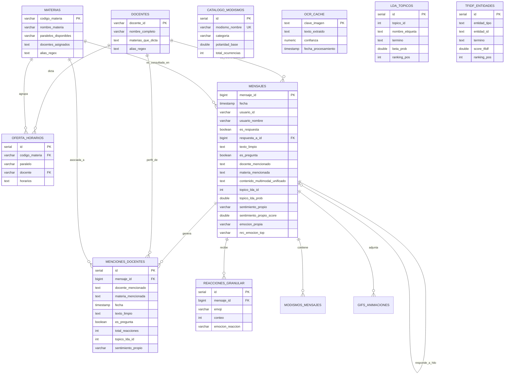

# ARCH-08: Persistencia, Modelo Relacional y Optimización Serverless (Neon PostgreSQL)

## 1. Identificación y Propósito
* **Archivos Fuente:** [`database/schema.sql`](file:///c:/Users/julio/Downloads/INF_2_2026/DM/DMProyAnalisisSentimiento/database/schema.sql), [`database/connection.py`](file:///c:/Users/julio/Downloads/INF_2_2026/DM/DMProyAnalisisSentimiento/database/connection.py), [`database/execute_nlp_migration_neon.py`](file:///c:/Users/julio/Downloads/INF_2_2026/DM/DMProyAnalisisSentimiento/database/execute_nlp_migration_neon.py) y [`app/models/schema.py`](file:///c:/Users/julio/Downloads/INF_2_2026/DM/DMProyAnalisisSentimiento/app/models/schema.py).
* **Objetivo:** Garantizar la integridad referencial, durabilidad y alta velocidad de consulta sobre la base de datos distribuida en la nube **Neon Serverless PostgreSQL (PostgreSQL 18.x en la región sa-east-1)**, configurando pooling de conexiones resiliente a suspensión por inactividad (*scale-to-zero*), índices de búsqueda textual en español (GIN FTS) y vistas analíticas materializables.

---

## 2. Especificación del Modelo Relacional (Diagrama Entidad-Relación)



---

## 3. Catálogo de Tablas del Sistema (14 Tablas)

1. **`docentes`:** Catálogo de 85 docentes titulares e interinos de la UMSA.
2. **`materias`:** 158 asignaturas con paralelos y docentes autorizados.
3. **`oferta_horarios`:** 267 asignaciones de horarios y aulas por materia y paralelo.
4. **`mensajes`:** Fact Table central (23,462 mensajes estudiantiles) enriquecida con columnas de PLN, tópicos LDA y contenido multimodal.
5. **`menciones_docentes`:** 3,734 interacciones vinculadas a docentes específicos.
6. **`reacciones_granular`:** 2,575 eventos de reacciones por emoji y emoción.
7. **`modismos_mensajes`:** Ocurrencias individuales de modismos con contexto por mensaje.
8. **`catalogo_modismos`:** Consolidado analítico de jerga y expresiones bolivianas.
9. **`diccionario_jergas`:** Definiciones lexicográficas de modismos en el contexto UMSA.
10. **`eventos_servicio`:** 4,538 logs de auditoría de Telegram (altas, bajas, pines).
11. **`gifs_animaciones`:** Metadatos de archivos multimedia y dimensiones.
12. **`ocr_cache`:** Registro hash y textos extraídos por Tesseract.
13. **`lda_topicos`:** Distribución de vocabulario de la Matriz $\beta$ (80 registros).
14. **`tfidf_entidades`:** Términos de máxima especificidad por docente, materia y ciclo formativo.

---

## 4. Vistas Analíticas Dinámicas

1. **`vista_ranking_docentes`:** Agrega volumen total de menciones, reacciones promedio recibidas y consultas estudiantiles acumuladas.
2. **`vista_resumen_materias`:** Agrega conteo de mensajes, materias con mayor interacción y docentes asociados.
3. **`vista_tendencia_temporal_sentimiento`:** Agrupa por mes (`YYYY-MM`) para graficar la evolución histórica de polaridad.
4. **`vista_perfil_emocional_docentes`:** Cruza cada docente con las 5 emociones del léxico UMSA y calcula el porcentaje relativo de aprobación vs. descontento.

---

## 5. Estrategia de Índices y Búsqueda de Texto Completo (FTS)

Para garantizar tiempos de respuesta sub-milisegundo en tableros ejecutivos:
* **Índices B-Tree Estándar:**
  ```sql
  CREATE INDEX idx_mensajes_fecha ON mensajes(fecha);
  CREATE INDEX idx_mensajes_docente ON mensajes(docente_mencionado);
  CREATE INDEX idx_menciones_docente ON menciones_docentes(docente_mencionado);
  CREATE INDEX idx_reacciones_mensaje ON reacciones_granular(mensaje_id);
  ```
* **Índice Invertido Generalizado (GIN) para Full-Text Search en Español:**
  Permite búsquedas lingüísticas con lematización y descarte de stopwords nativo de PostgreSQL:
  ```sql
  CREATE INDEX idx_mensajes_fts_es 
  ON mensajes USING gin(to_tsvector('spanish', coalesce(texto_limpio, '')));
  ```

---

## 6. Configuración de Conexión Serverless y Pooling

Las bases de datos *Serverless* como **Neon** suspenden los nodos de cómputo tras periodos de inactividad para ahorrar recursos (*scale-to-zero*). Si una aplicación web intenta reutilizar una conexión cerrada abruptamente por el balanceador, se produce un error `OperationalError: SSL connection has been closed unexpectedly`.

Para neutralizar este fenómeno, [`database/connection.py`](file:///c:/Users/julio/Downloads/INF_2_2026/DM/DMProyAnalisisSentimiento/database/connection.py) y [`app/config.py`](file:///c:/Users/julio/Downloads/INF_2_2026/DM/DMProyAnalisisSentimiento/app/config.py) configuran el motor SQLAlchemy con los siguientes parámetros defensivos:
```python
engine = create_engine(
    DATABASE_URL,
    pool_pre_ping=True,   # Valida la conexión ejecutando 'SELECT 1' antes de usarla
    pool_recycle=300,     # Recicla las conexiones cada 5 minutos antes del timeout de Neon
    pool_size=5,          # Conexiones simultáneas moderadas para no agotar el pool
    max_overflow=10       # Conexiones adicionales de pico bajo carga transitoria
)
```

---

## 7. Instrucciones de Migración y Sembrado

### Ejecución de Migración DDL y Siembra en Neon:
```powershell
# 1. Aplicar esquema base
python -c "from database.connection import init_db; init_db()"

# 2. Aplicar migraciones avanzadas de PLN y sembrado de tópicos/TF-IDF
python database/execute_nlp_migration_neon.py
```

### Verificación de Estado:
```powershell
python -c "from database.queries import get_neon_health_telemetry; print(get_neon_health_telemetry())"
```
Salida esperada:
```json
{
  "status": "Conectado y Operativo",
  "engine": "Neon Serverless PostgreSQL",
  "database": "TGBase",
  "region": "sa-east-1",
  "tables_count": 14,
  "views_count": 4
}
```

---

## 8. Consideraciones de Seguridad y Resiliencia
* **Credenciales Sanitizadas:** La URL de base de datos se almacena en `.env` bajo `DATABASE_URL` y se adapta automáticamente de `postgres://` a `postgresql+psycopg2://`.
* **Fallback Defensivo en Flask:** Si la conexión a Neon sufre latencia extrema o desconexión transitoria, el controlador [`dashboard.py`](file:///c:/Users/julio/Downloads/INF_2_2026/DM/DMProyAnalisisSentimiento/app/routes/web/dashboard.py#L41-L69) conmuta automáticamente a métricas cacheadas en memoria, impidiendo una pantalla de error 500 para el usuario.
